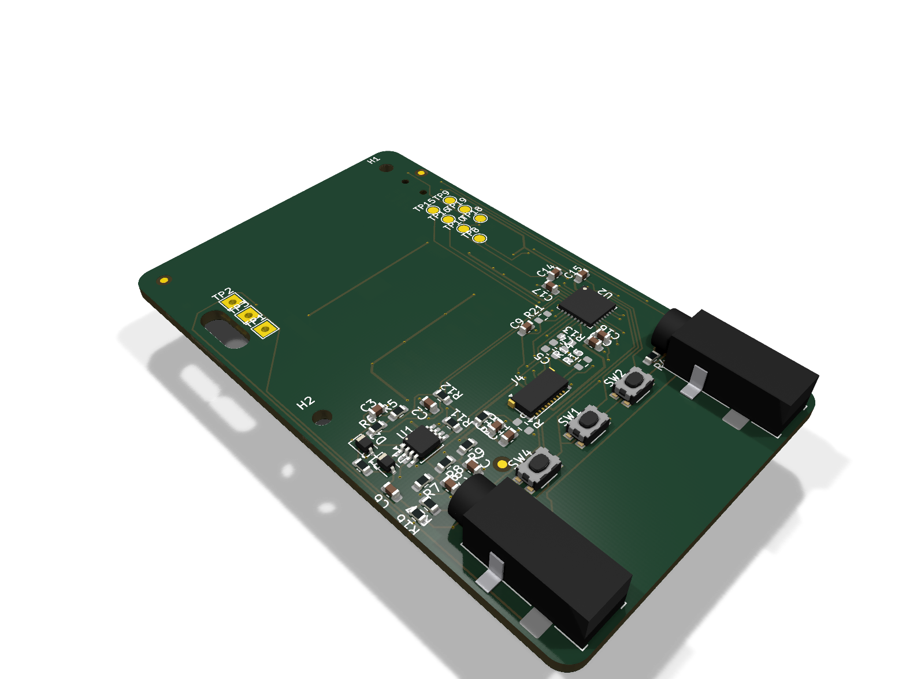
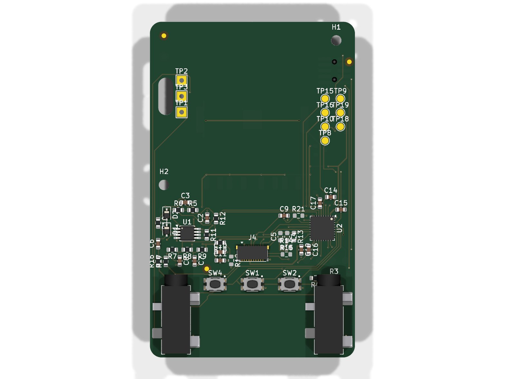
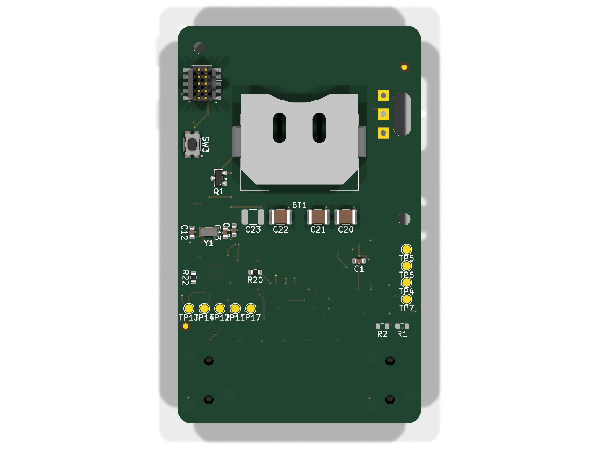

# Funbbit

A modern recreation of the Sony PET-F7 "Funbbit" (1998): a virtual-pet
accessory for a Walkman (or any 3.5 mm player). It sits inline between the
player and the headphones, taps the audio without disturbing it, and animates
a pet on a 1.28" Sharp monochrome memory LCD. The pet dances while music plays
("dancing pet", "weight battle") and gets fat when it does not. An STM32U083
runs everything from a single **CR2032** coin cell.

## Renders



| Top | Bottom |
| --- | --- |
|  |  |

Rendered from `eda/eda.kicad_pcb` with KiCad 10:

```sh
kicad-cli pcb render eda/eda.kicad_pcb -o docs/renders/top.png --side top --quality high -w 1600 -h 1200 --zoom 0.9
kicad-cli pcb render eda/eda.kicad_pcb -o docs/renders/bottom.png --side bottom --quality high -w 1600 -h 1200 --zoom 0.9
kicad-cli pcb render eda/eda.kicad_pcb -o docs/renders/iso.png --rotate '-45,0,45' --perspective --quality high -w 1600 -h 1200 --zoom 0.9
```

## Pixel art

Pet sprites are drawn in [Aseprite](https://www.aseprite.org/).
